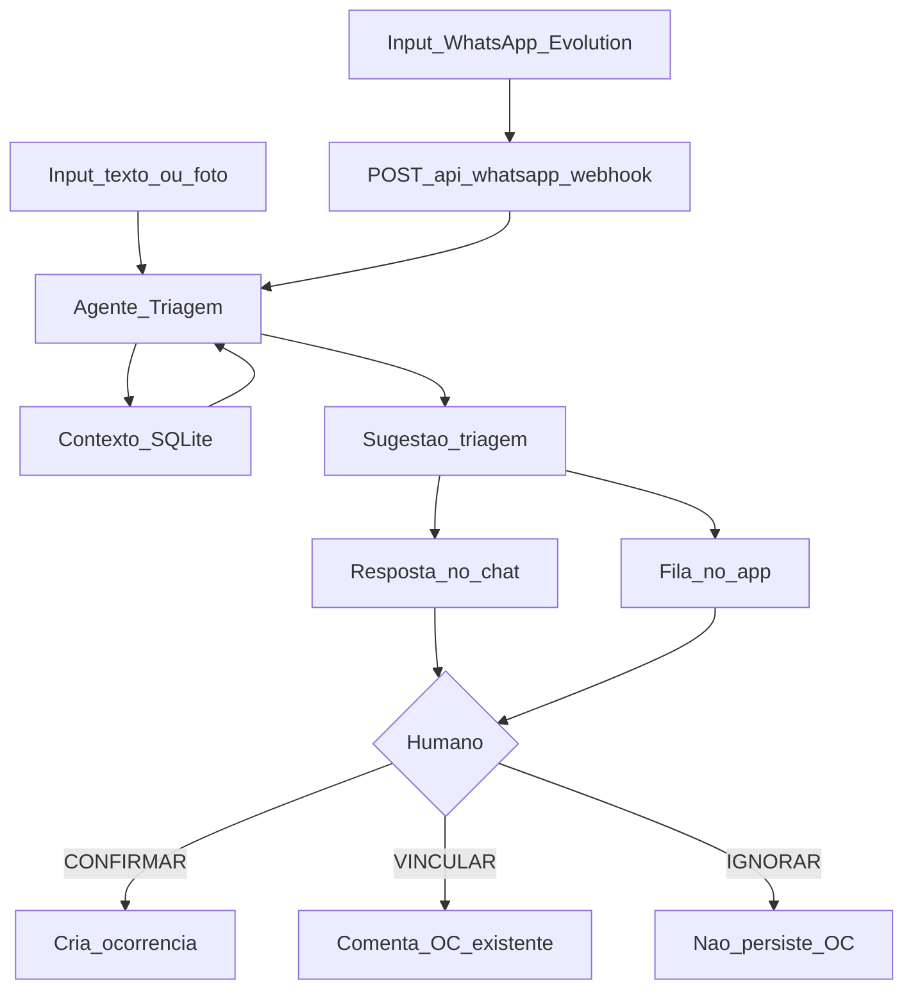

# Fluxo do agente de IA — Prediza

Documentação de **inputs → lógica → outputs** do agente de triagem (WhatsApp + app).  
Resumo também no [`README.md`](../README.md).

---

## Papel do agente

Capturar relatos de manutenção, classificar com contexto do edifício e **só persistir ocorrência após confirmação humana**.

Não é: gravador do grupo · criador automático sem revisão · substituto do WhatsApp.

---

## Diagrama



---

## Inputs

| Fonte | Endpoint / UI | Campos |
| --- | --- | --- |
| App | `POST` server action `triageTextAction` · `/ai/triage` | `text`, `photo?`, `caption?` |
| WhatsApp (Evolution) | `POST /api/whatsapp/webhook` | payload `messages.upsert` ou JSON simples `{ buildingSlug, body, authorName? }` |
| Simulação | `/whatsapp` | mesmo pipeline, sem reply externo |
| Confirmação | chat (`CONFIRMAR n`) ou botões no app | `action`: create / link / ignore |

### Contexto injetado na lógica (sempre)

- `systems[]` do `buildingId` (id, name, category)
- `openOccurrences[]` (aberta / programada / em_execução)

Código: [`src/lib/ai/triage.ts`](../src/lib/ai/triage.ts) · [`src/lib/whatsapp/inbound.ts`](../src/lib/whatsapp/inbound.ts)

---

## Lógica

### 1. Pré-filtros (WhatsApp)

- Ignora `fromMe`
- Opcional: exige menção a Prediza (`EVOLUTION_REQUIRE_MENTION=1`)
- Dedupe por `messageId` ou texto recente igual
- Comandos `CONFIRMAR|VINCULAR|IGNORAR {id}` → resolvem evento pendente

### 2. Motor `runTriage`

1. **Heurística própria (sempre roda)**  
   - Ruído social → `classification: ignorar`  
   - Keywords → prioridade + categoria de sistema  
   - Match com OC aberta (tokens + mesmo sistema) → `duplicata`  
   - Senão → `nova`
2. **OpenAI (opcional)** se `OPENAI_API_KEY` — refina título/prioridade; **fallback** = heurística

### 3. Persistência intermediária

- `whatsapp_events` (fila)
- `ai_suggestions` (JSON do resultado + `whatsappEventId`)

### 4. Gate humano (obrigatório para criar OC)

Sem CONFIRMAR / “Criar ocorrência” no app → **não** há ocorrência nova definitiva no domínio Prediza (ruído pode ficar só como `ignored`).

---

## Outputs

| Output | Destino | Conteúdo |
| --- | --- | --- |
| Classificação | App + reply WA | `nova` \| `duplicata` \| `ignorar` |
| Sugestão | App / JSON | título, descrição, prioridade, sistema, confiança, rationale, engine |
| Mensagem ao grupo | Evolution `sendText` | texto pedindo CONFIRMAR / VINCULAR / IGNORAR |
| Ocorrência | tabela `occurrences` | após confirmação; `source`: `whatsapp` \| `ai` |
| Evento de timeline | `occurrence_events` | criação / comentário |

### Exemplo de output da triagem (JSON conceitual)

```json
{
  "classification": "nova",
  "title": "Infiltração na garagem",
  "priority": "alta",
  "suggestedSystemName": "Bombas de recalque",
  "matchedOccurrenceId": null,
  "confidence": 0.65,
  "engine": "heuristic",
  "rationale": "Sugestão pelo sistema Bombas e palavras-chave"
}
```

---

## Como rodar a demo do protótipo

Ver [`demo-agente.md`](./demo-agente.md).

```bash
npm install && npm run db:push && npm run db:seed && npm run dev
# Login: sindico@prediza.demo / prediza123
# Mais → WhatsApp → simular mensagem → Confirmar
```

Webhook Evolution: [`whatsapp-evolution.md`](./whatsapp-evolution.md).
