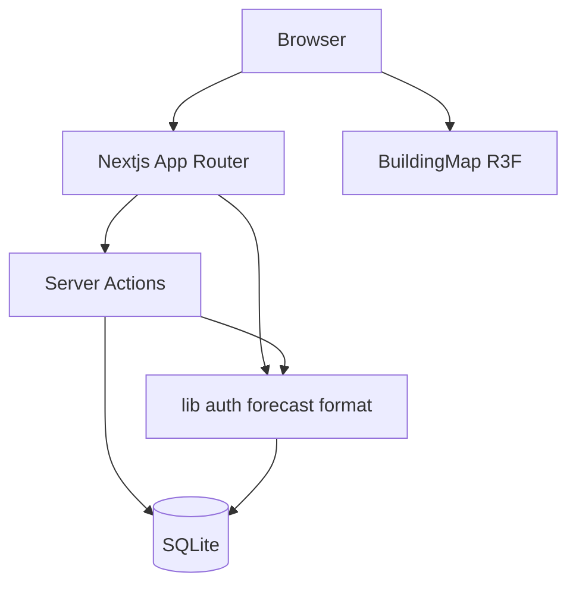

# Arquitetura

## Stack

| Camada | Tecnologia |
| --- | --- |
| Framework | Next.js 16 (App Router) |
| UI | React 19 + Tailwind CSS 4 |
| Banco | SQLite (`better-sqlite3`) |
| ORM | Drizzle ORM |
| 3D | Three.js + React Three Fiber + Drei |
| Auth | Cookie HTTP-only assinado (HMAC) + bcrypt |
| Datas | date-fns |

Arquivo do banco (dev): `data/prediza.sqlite`.

## Diagrama lógico



## Estrutura de pastas

```text
src/
  app/
    (app)/           # rotas autenticadas (shell + páginas)
      dashboard/     # home de decisão
      systems/       # fichas de sistema
      delivery/      # entrega digital (construtora)
      occurrences/   # ocorrências
      map/           # mapa 3D + registro
      maintenance/   # preventivo NBR 5674
      works/         # obras NBR 16280
      forecast/      # relatório assembleia
    actions/         # server actions (mutações)
    login/
  components/        # AppShell, BuildingMap, UI
  db/                # schema, conexão, seed
  lib/               # auth, forecast, format
data/                # SQLite local (gitignored)
docs/                # esta documentação
```

## Padrões

- **Server Components** para leitura (páginas listam direto via Drizzle).
- **Server Actions** para escrita (`src/app/actions/*`).
- Layout `(app)` exige sessão (`dynamic = "force-dynamic"`).
- Isolamento por `buildingId` da membership do usuário logado.
- Previsão recalculada por `rebuildForecast(buildingId)` após mudanças em sistemas, planos, obras ou entrega.

## Mapa 3D

[`BuildingMap.tsx`](../src/components/BuildingMap.tsx) renderiza um volume simplificado do edifício e marcadores (sistemas em verde, ocorrências em laranja). Clique no volume define `mapX/Y/Z` para nova ocorrência. Evolução futura: GLB real por `model_versions` (ainda não persistido no schema atual).
