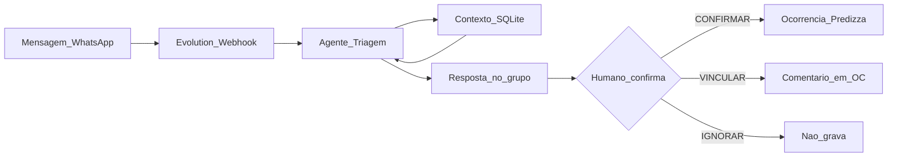

# Predizza — Material para avaliação do evento

Critérios: Problema (20%) · Solução/IA (30%) · Diferencial/viabilidade (20%) · Equipe (15%) · Pitch (15%).

Use este doc como **roteiro de evidências + falas**. Preencha os trechos `[ ]` com dados reais da equipe.

---

## 1. Problema e validação (20%)

### Problema (uma frase)

A memória de manutenção do condomínio se perde entre WhatsApp, planilha e troca de síndico — e a assembleia decide reserva **sem número confiável**.

### Delimitação (o que NÃO é)

| Não competimos com | Por quê |
| --- | --- |
| Portal de boleto / assembleia digital | Não resolvem preventiva + custo futuro |
| CAFM/BIM enterprise | Caros, lentos, síndica não usa |
| “Bot que arquiva o grupo” | LGPD + ruído; não gera decisão |

**Escopo:** condomínio residencial médio (~40–200 unidades), síndica/administradora + construtora no handover.

### Persona âncora

**Ana Ribeiro** — síndica, celular-first, julgada na assembleia.  
Quer: *não passar vergonha*, saber quanto reservar, transformar foto do grupo em tarefa com prazo.  
Não quer: virar engenheira nem cadastrar BIM.

**Ricardo** (secundário / canal) — engenheiro da construtora. Entrega digital + lê pós-obra. Distribui a Predizza no handover.

Detalhe: [`personas.md`](./personas.md).

### Evidências (montar antes do pitch)

Preencha com o que vocês tiverem. Quanto mais primário, melhor.

| Tipo | O que mostrar | Status |
| --- | --- | --- |
| Entrevistas | N síndicas / N construtoras; citação de 1 frase cada | `[ ]` |
| Observação | Análise do MVP Predio360 (Netlify) — ocorrências no mapa, mas sem previsão/assembleia | Feito (base do repo) |
| Sintoma de mercado | Softwares de condomínio = boleto + ata; manutenção continua no WhatsApp | Argumento |
| Piloto | 1 edifício · métrica 30 dias: 1 pauta exportada + ≥5 OCs confirmadas do WhatsApp | `[ ]` meta |
| Dados proxy | Tempo médio montando planilha de assembleia; nº de threads de infiltração/mês | `[ ]` |

**Fala de validação (15 s):**  
“Falamos com síndicas que montam a assembleia em planilha e perdem o fio no grupo do condomínio. O MVP anterior provou pin no mapa; o que faltava — e o que validamos na Predizza — é **número de reserva + confirmação humana no WhatsApp**.”

Se ainda não houver entrevistas formais: seja honesto — “validação em curso; hipótese priorizada por persona e pelo gap do MVP” — e mostre o **protocolo** de 5 perguntas (abaixo).

#### Protocolo rápido (5 perguntas — síndica)

1. Como você monta hoje a reserva da assembleia?  
2. Onde vive a última infiltração / bomba / elevador?  
3. O que acontece quando troca o síndico?  
4. Você topa um bot no grupo se **só gravar com sua confirmação**?  
5. Quanto pagaria (ou quem pagaria) por “chegar com o número certo”?

---

## 2. Solução e uso de IA (30%)

### Solução (wedge)

**Kit de assembleia + memória viva do prédio.**  
Construtora enche o tanque (wizard de entrega). Síndica dirige (R$ a reservar, risco se adiar, confirmar WhatsApp).

### Onde a IA é **central** (não cosmética)

| Fluxo | Papel da IA / agente | Humano no loop |
| --- | --- | --- |
| **Agente WhatsApp** | Classifica relato (nova / duplicata / ruído), sugere sistema e prioridade, responde no grupo | CONFIRMAR / VINCULAR / IGNORAR |
| Triagem no app | Texto + foto → sugestão de ocorrência | Aceita / edita / ignora |
| Assembleia | Gera pauta em linguagem simples a partir do forecast | Exporta PDF / cola no conselho |
| Planos | Sugere preventivas faltantes + alerta de padrão repetido | Síndica/técnico aplica |

**Princípio LGPD:** a Predizza **não** é gravador do grupo. Ativo = memória **confirmada**.

### Profundidade de engenharia (o que falar)

1. **Agente com ferramentas de domínio:** contexto do `buildingId` (sistemas + OCs abertas no SQLite) → triagem → escrita só após confirmação.  
2. **Dois motores:** heurística própria (keywords + match de duplicata) + OpenAI opcional — **nunca bloqueia** sem API key ([`ia.md`](./ia.md)).  
3. **Integração real:** Evolution API (webhook `MESSAGES_UPSERT`, dedupe, reply).  
4. **Ativo próprio:** fichas de sistema + forecast recalculável + histórico de OC (não é só chat wrapper).  
5. Ordem de produto: **Decisão → dados → IA → planta → BIM** (BIM secundário).

### Diagrama do agente (demo)

### Ativo próprio (checklist para a banca)

- [x] Modelo de dados do edifício (sistemas, planos, forecast, OCs)  
- [x] Motor de previsão 12m / 3a / agir agora  
- [x] Pipeline de triagem + dedupe  
- [x] Wizard de entrega (gera ativo no handover)  
- [ ] Dataset anotado de relatos (próximo passo — aumenta nota de IA)

---

## 3. Diferencial e viabilidade (20%)

### Vantagem vs alternativas

| Alternativa | Limitação | Predizza |
| --- | --- | --- |
| Grupo WhatsApp | Ruído, sem prazo, sem custo | Fila + confirmação + OC |
| Planilha da síndica | Morre na troca de mandato | Histórico no edifício |
| App de condomínio (boleto) | Não fala preventiva/reserva | Kit assembleia em R$ |
| CAFM / BIM | Overkill para Ana | IA e decisão **antes** do IFC |

**Diferencial em uma linha:**  
*WhatsApp seletivo com humano no loop + número de assembleia em cima da memória do prédio, vendido no handover da construtora.*

### Modelo de negócio (proposta)

| Camada | Quem paga | O quê |
| --- | --- | --- |
| **Land** | Construtora | Predizza no pacote de entrega (1º ano / N unidades) |
| **Expand** | Administradora / condomínio | Assinatura anual por edifício (síndica + técnico) |
| **Upsell** | Construtora | Portfólio pós-obra + lessons learned |

**Unit economics (hipótese — calibrar):**  
Assinatura edifício R$ 200–600/mês · CAC via construtora baixo · churn baixo se a memória acumulada for o lock-in.

### Escala

1. Vertical: muitos edifícios da **mesma** construtora (portfólio).  
2. Horizontal: administradoras com carteira de condomínios.  
3. Dados: quanto mais OCs confirmadas, melhor a triagem e o forecast (flywheel).

---

## 4. Equipe (15%)

### Preencher

| Pessoa | Papel no projeto | Superpoder | Aderência ao problema |
| --- | --- | --- | --- |
| `[Nome]` | `[ex.: produto / full-stack]` | `[ ]` | `[ ]` |
| `[Nome]` | `[ex.: IA / dados]` | `[ ]` | `[ ]` |
| `[Nome]` | `[ex.: negócio / construtoras]` | `[ ]` | `[ ]` |

### Fala de complementaridade (modelo)

“Somos `[N]` pessoas: quem constrói o produto, quem amarra o agente de IA ao domínio do edifício, e quem abre porta com construtora/síndica. A evolução no programa: de mapa 3D (MVP) → previsão + kit assembleia → agente WhatsApp com confirmação humana.”

### Evidência de evolução

1. Pitch e naming Predizza  
2. App Next.js + SQLite (decisão, fichas, forecast)  
3. IA + Evolution (agente no grupo)  
4. Reposicionamento: **síndica primeiro**, construtora como canal  

---

## 5. Pitch 3 minutos + demo do agente (15%)

### Cronômetro

| Tempo | Bloco | Conteúdo |
| --- | --- | --- |
| 0:00–0:25 | Gancho | Assembleia sem número; manutenção no WhatsApp |
| 0:25–0:50 | Persona | Ana — o que ela teme e o que precisa |
| 0:50–1:20 | Solução | Kit assembleia + memória; construtora entrega |
| 1:20–2:20 | **Demo agente** | Ver roteiro abaixo |
| 2:20–2:45 | Diferencial + negócio | Seletivo ≠ dump; land via construtora |
| 2:45–3:00 | Pedido | Piloto 1 edifício / métrica 30 dias |

### Script falado (~3 min)

> Em todo condomínio a manutenção mora no WhatsApp e a assembleia decide no escuro. A síndica Ana não quer BIM — ela quer **não passar vergonha** e saber **quanto reservar**.
>
> A **Predizza** é o kit de assembleia: o mapa e as fichas do prédio viram **número em reais** — o que reservar em 12 meses e o risco se adiar. A construtora entrega o edifício digitalmente; a síndica só decide.
>
> O coração de IA é um **agente no WhatsApp**: a mensagem entra pela Evolution, a Predizza lê o contexto do edifício — sistemas e ocorrências abertas — classifica se é nova, duplicata ou ruído, e **responde pedindo confirmação**. Só depois de CONFIRMAR a ocorrência nasce. Não somos um gravador do grupo: somos memória com consentimento.
>
> Diferente de portal de boleto ou CAFM caro, vendemos no handover e expandimos com a administradora. Pedimos um piloto: um edifício, trinta dias, uma pauta exportada e relatos confirmados no app.

### Demo do agente (60–70 s) — ordem na tela

1. **Início** — mostrar “Reservar (12 meses)” + “Risco se adiar”.  
2. **WhatsApp** — simular: *“Predizza — infiltração na garagem perto da bomba”*.  
3. Mostrar triagem (classificação / sistema / prioridade).  
4. **CONFIRMAR** → ocorrência criada.  
5. Voltar ao **Início** ou **Assembleia** — número atualizado / item na pauta.  
6. (Opcional 5 s) Dizer: “Com Evolution ligada, o mesmo fluxo roda no grupo real.”

### Checklist técnico antes do pitch

- [ ] `npm run dev` + seed  
- [ ] Login `sindico@predizza.demo` / `predizza123`  
- [ ] Simulação WhatsApp testada  
- [ ] Backup: print da pauta `/forecast/print`  
- [ ] Se Evolution cair: demo só com simulação (mesmo agente)

---

## Slide deck e one-pager

- **8 slides (copiar/colar):** [`pitch-slides.md`](./pitch-slides.md)  
- **One-pager da banca:** [`one-pager-banca.md`](./one-pager-banca.md)  

---

## Como maximizar nota por critério

| Critério | O que a banca quer ouvir | O que entregar |
| --- | --- | --- |
| Problema 20% | Evidência, não só feeling | Entrevistas ou protocolo + citação + gap do MVP |
| IA 30% | Agente central + engenharia + ativo | Demo WhatsApp + SQLite contexto + heurística própria |
| Diferencial 20% | Por que vence e como escala | Tabela vs alternativas + land construtora |
| Equipe 15% | Complementaridade + evolução | Tabela de papéis + linha do tempo do programa |
| Pitch 15% | 3 min claros + fluxo do agente | Cronômetro + demo ensaiada |

---

## Próximos 48 h (se faltar evidência)

1. 3 conversas de 15 min com síndica/zelador (protocolo acima).  
2. Gravar 1 take da demo do agente (backup se Wi-Fi falhar).  
3. Preencher tabela da equipe.  
4. Uma frase de preço hipotético (mesmo que “a validar no piloto”).
