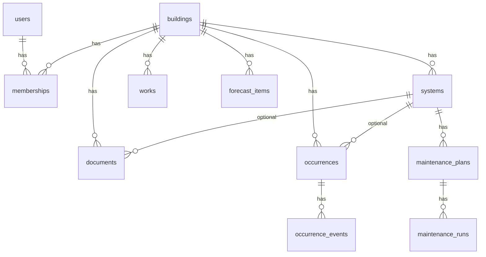

# Modelo de dados

Schema: [`src/db/schema.ts`](../src/db/schema.ts).

## Papéis (`Role`)

`construtora` | `sindico` | `gestor` | `tecnico` | `fornecedor`

Um usuário tem **membership** em um edifício com um papel.

## Tabelas

### Identidade e acesso

| Tabela | Função |
| --- | --- |
| `users` | e-mail, nome, `password_hash` |
| `buildings` | condomínio (`slug`, nome, endereço) |
| `memberships` | user ↔ building + `role` |

### Patrimônio

| Tabela | Função |
| --- | --- |
| `systems` | ficha de sistema (categoria, specs, garantia, periodicidade, `next_due_at`, custo, coordenadas do modelo) |
| `documents` | entrega digital (planta, memorial, manual, garantia…), opcionalmente ligada a um sistema |

### Operação

| Tabela | Função |
| --- | --- |
| `occurrences` | ocorrência espacial (`code`, status, prioridade, prazo, ponto xyz, sistema) |
| `occurrence_events` | histórico (criação, mudança de status, notas) |

Status de ocorrência: `aberta` → `programada` → `em_execucao` → `executada` → `concluida` | `cancelada`.

Prioridades: `baixa` | `media` | `alta` | `urgente` (prazo automático em dias: 30 / 15 / 7 / 2).

### Preventivo e obras

| Tabela | Função |
| --- | --- |
| `maintenance_plans` | plano preventivo por sistema |
| `maintenance_runs` | execução registrada (avança `next_due_at`) |
| `works` | obras/reformas (período, responsável, custo) |

### Previsão

| Tabela | Função |
| --- | --- |
| `forecast_items` | itens derivados (`source`: sistema \| plano \| obra), `due_at`, custo, `urgency` |

Urgência:

- `agir_agora` — até ~3 meses
- `12_meses` — até 12 meses
- `3_anos` — horizonte de 3 anos

Recálculo: [`src/lib/forecast.ts`](../src/lib/forecast.ts) → `rebuildForecast`.

## Relação conceitual

